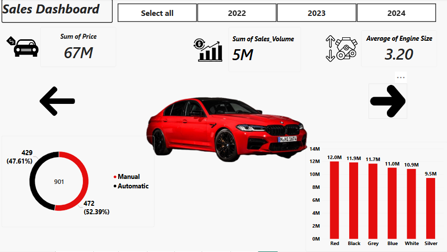
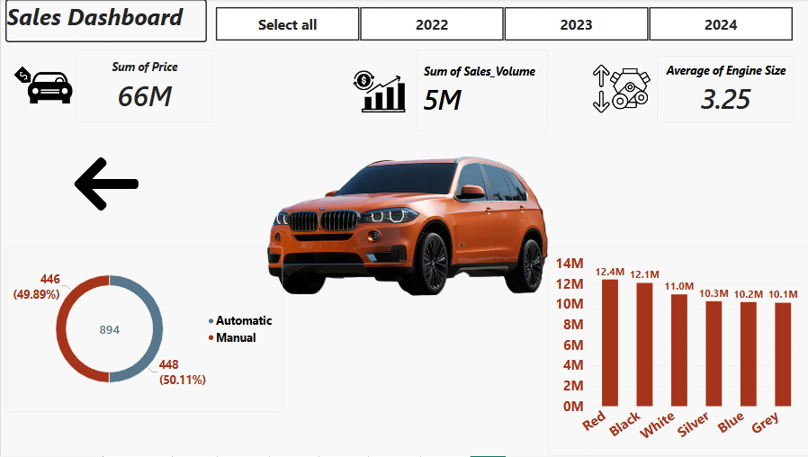

<div align="center">

# 🚗 BMW Cars Sales Dashboard | Power BI
### Turning BMW Sales Data into Business Insights

[](https://powerbi.microsoft.com/)
[](https://learn.microsoft.com/en-us/dax/)
[](#)

<p align="center">
  <b>An interactive Business Intelligence project exploring BMW sales across six popular models, comparing price, sales volume, engine size, transmission type, and color preferences.</b>
</p>

</div>

---

## 📌 Project Overview

The **BMW Cars Sales Dashboard** is an interactive Power BI project built to explore how BMW models perform in terms of price, sales volume, engine size, transmission type, and color popularity.

Each model has its own dedicated page with the same layout, which makes it easy to flip through the models and compare them side by side. A year slicer lets the viewer filter the numbers by year.

### 📋 Project at a Glance

| Project Detail | Description |
| :--- | :--- |
| **Project Name** | BMW Cars Sales Dashboard |
| **Domain** | Automotive Sales Analytics |
| **Dashboard Period** | 2022 – 2024 |
| **Featured Models** | i8, M3, X3, X6, M5, X5 |
| **Source Dataset** | 50,000 records, 11 BMW models, 2010 – 2024 |
| **Records in Dashboard** | 5,514 (across the six featured models) |
| **Dashboard Pages** | 7 (Home + one page per model) |
| **Main Tool** | Microsoft Power BI Desktop |
| **Data Preparation** | Power Query (type casting, filtering) |
| **Calculations** | DAX / aggregations (price, sales volume, engine size, transmission count) |

> **Important:** `Price_USD` is the price of each record, so **Sum of Price** adds up listed prices. It is not revenue (price × volume).

---

## 📸 Dashboard Preview

### 1. Home Page
<p align="center">
  
</p>

> *The landing page with the BMW logo and a navigation menu listing every model: i8, M3, X3, X6, M5, and X5.*

### 2. BMW i8
<p align="center">
  
</p>

> *KPIs, transmission split, and price by color for the BMW i8.*

### 3. BMW M3
<p align="center">
  
</p>

> *The same layout for the BMW M3, with its own color theme.*

### 4. BMW X3
<p align="center">
  
</p>

> *KPIs, transmission split, and price by color for the BMW X3.*

### 5. BMW X6
<p align="center">
  
</p>

> *KPIs, transmission split, and price by color for the BMW X6.*

### 6. BMW M5
<p align="center">
  
</p>

> *KPIs, transmission split, and price by color for the BMW M5.*

### 7. BMW X5
<p align="center">
  
</p>

> *KPIs, transmission split, and price by color for the BMW X5.*

---

## 📑 Table of Contents
- [Project Overview](#-project-overview)
- [Dashboard Preview](#-dashboard-preview)
- [Business Objectives](#-business-objectives)
- [Dataset](#-dataset)
- [Data Preparation](#-data-preparation)
- [Dashboard Pages](#-dashboard-pages)
- [Key Features](#-key-features)
- [Key Performance Indicators](#-key-performance-indicators)
- [Key Insights](#-key-insights)
- [DAX Measures](#-dax-measures)
- [Project Demonstration](#-project-demonstration)
- [Download Dashboard](#-download-dashboard)
- [Repository Structure](#-repository-structure)
- [Limitations & Considerations](#-limitations--considerations)
- [About the Author](#-about-the-author)
- [Feedback](#-feedback)

---

## 🎯 Business Objectives

The project explores the following analytical questions:

- **Price & Volume:** How do total price and sales volume compare across the featured models?
- **Engine Size:** Do the models differ in average engine size?
- **Transmission Preference:** Do buyers lean toward manual or automatic transmissions?
- **Color Preference:** Which colors carry the highest total price for each model?
- **Time Filtering:** How do the numbers look for 2022, 2023, and 2024?

---

## 📂 Dataset

The dataset is a single flat table of BMW car sales records. It is included in this repository as [`BMW_Car_Sales_Classification.csv`](BMW_Car_Sales_Classification.csv).

| Detail | Value |
| :--- | :--- |
| **Rows** | 50,000 |
| **Columns** | 11 |
| **Years** | 2010 – 2024 |
| **Models** | 3 Series, 5 Series, 7 Series, X1, X3, X5, X6, M3, M5, i3, i8 |
| **Regions** | Asia, North America, Middle East, South America, Europe, Africa |
| **Missing Values** | None |

### Dataset Columns

| Column | Description |
| :--- | :--- |
| **`Model`** | BMW model name. |
| **`Year`** | Year of the record (2010 – 2024). |
| **`Region`** | Sales region. |
| **`Color`** | Car color (Red, Blue, Black, Silver, White, Grey). |
| **`Fuel_Type`** | Petrol, Diesel, Hybrid, or Electric. |
| **`Transmission`** | Manual or Automatic. |
| **`Engine_Size_L`** | Engine size in liters. |
| **`Mileage_KM`** | Mileage in kilometers. |
| **`Price_USD`** | Price in US dollars. |
| **`Sales_Volume`** | Number of units sold. |
| **`Sales_Classification`** | Sales level label: High or Low. |

---

## 🧹 Data Preparation

**Power Query** was used to prepare the dataset before reporting:

1. **Importing & Verification:** Loaded the CSV file and checked it for missing or inconsistent values.
2. **Data Type Casting:** Applied currency format to price, whole numbers to sales volume and year, and decimal numbers to engine size.
3. **Filtering:** Focused the report on the six featured models and the 2022 – 2024 period.

---

## 🗂️ Dashboard Pages

| # | Page | Purpose |
| :-: | :--- | :--- |
| 1 | **Home** | BMW logo and a menu of all featured models. |
| 2 | **i8** | KPIs, transmission split, and price by color. |
| 3 | **M3** | Same layout, in a blue theme. |
| 4 | **X3** | Same layout, in a grey theme. |
| 5 | **X6** | Same layout, in a green theme. |
| 6 | **M5** | Same layout, in a red theme. |
| 7 | **X5** | Same layout, in an orange theme. |

---

## ✨ Key Features

- 🧭 **Easy navigation:** a model menu on the home page and left/right arrows on every page.
- 📅 **Year slicer:** Select all, 2022, 2023, or 2024.
- 🎨 **Model-specific themes:** each page's colors match the car shown on it.
- 🚘 **Car imagery:** a photo of each model on its own page.
- 📊 **Three visuals per page:** KPI cards, a transmission donut chart, and a price-by-color bar chart.

---

## 📈 Key Performance Indicators

Each model page shows three KPI cards: **Sum of Price**, **Sum of Sales_Volume**, and **Average of Engine Size**. The table below summarizes them, along with the transmission split.

| Model | Sum of Price | Sales Volume | Avg. Engine Size (L) | Records | Manual | Automatic |
| :--- | :---: | :---: | :---: | :---: | :---: | :---: |
| **i8** | 69M | 4.72M | 3.20 | 922 | 486 (52.71%) | 436 (47.29%) |
| **M3** | 67M | 4.57M | 3.26 | 892 | 445 (49.89%) | 447 (50.11%) |
| **X3** | 70M | 4.81M | 3.25 | 937 | 473 (50.48%) | 464 (49.52%) |
| **X6** | 73M | 5.09M | 3.23 | 968 | 507 (52.38%) | 461 (47.62%) |
| **M5** | 67M | 4.62M | 3.20 | 901 | 472 (52.39%) | 429 (47.61%) |
| **X5** | 66M | 4.54M | 3.25 | 894 | 446 (49.89%) | 448 (50.11%) |

> The dashboard's sales volume cards show **5M** for every model because of rounding. The table gives the more precise values.

---

## 💡 Key Insights

### 💰 Price & Volume
- **BMW X6** leads both in total price (**73M**) and in sales volume (**5.09M**).
- **X3 (70M)** and **i8 (69M)** follow. **M3 and M5 (67M each)** and **X5 (66M)** are close behind.
- The gap between the top and bottom model is only about 7M, so no single model dominates.

### ⚙️ Engine Size
- Average engine size is nearly identical across the models, between **3.20 L** and **3.26 L**.
- **M3** has the highest average (3.26 L), while **i8** and **M5** have the lowest (3.20 L).

### 🔧 Transmission
- Buyers are split almost evenly between manual and automatic.
- **Manual** is slightly ahead for the **i8 (52.71%)**, **M5 (52.39%)**, and **X6 (52.38%)**.
- **Automatic** is slightly ahead for the **M3** and **X5** (50.11% each).

### 🎨 Color Preference
- **Blue** brings the highest total price for the **i8 (13.3M)**, **X3 (13.2M)**, and **X6 (13.2M)**.
- **Red** leads for the **M5 (12.0M)** and **X5 (12.4M)**, and **Grey** leads for the **M3 (12.0M)**.
- The weakest colors are **Grey** for the i8 (9.9M) and **Silver** for the M5 (9.5M).
- Differences between colors are modest, typically within 2–4M.

---

## 🧮 DAX Measures

The KPI cards use standard aggregations. The equivalent DAX is shown below; the exact versions are inside the `.pbix` file.

```DAX
Sum of Price = SUM ( BMW_Car_Sales_Classification[Price_USD] )

Sum of Sales_Volume = SUM ( BMW_Car_Sales_Classification[Sales_Volume] )

Average of Engine Size = AVERAGE ( BMW_Car_Sales_Classification[Engine_Size_L] )

Transmission Count = COUNTROWS ( BMW_Car_Sales_Classification )
```

---

## 🎬 Project Demonstration

A full walkthrough of the dashboard is available as a video. Click the image or the link below to watch it:

<p align="center">
  <a href="BMW_Cars_Dashboard.mp4">
    
  </a>
  <br />
  <b>▶️ <a href="BMW_Cars_Dashboard.mp4">Watch the demo video</a></b>
</p>

---

## ⬇️ Download Dashboard

| File | Description |
| :--- | :--- |
| 📊 [**Cars_Dashboard.pbix**](Cars_Dashboard.pbix?raw=true) | The Power BI report file. Open it with **Power BI Desktop**. |
| 🎬 [**BMW_Cars_Dashboard.mp4**](BMW_Cars_Dashboard.mp4) | Video walkthrough of the project. |
| 📁 [BMW_Car_Sales_Classification.csv](BMW_Car_Sales_Classification.csv) | The source dataset. |

---

## 🗃️ Repository Structure

```
📦 BMW-Cars-Dashboard
 ┣ 📄 README.md
 ┣ 📊 Cars_Dashboard.pbix
 ┣ 🎬 BMW_Cars_Dashboard.mp4
 ┣ 📄 BMW_Car_Sales_Classification.csv
 ┣ 🖼️ D1_1.PNG  (Home)
 ┣ 🖼️ D2_1.PNG  (i8)
 ┣ 🖼️ D3_1.PNG  (M3)
 ┣ 🖼️ D4_1.PNG  (X3)
 ┣ 🖼️ D5_1.PNG  (X6)
 ┣ 🖼️ D6.PNG    (M5)
 ┗ 🖼️ D7.PNG    (X5)
```

---

## ⚠️ Limitations & Considerations

- The dataset looks **synthetic/educational**: for example, the i8 and i3 show an average engine size of about 3.2 L, and values are spread very evenly across models, colors, and transmissions. Results should not be read as real BMW market data.
- The source file covers **2010 – 2024** and **11 models**, while the dashboard focuses on **2022 – 2024** and **six models**.
- **Sum of Price** adds up the price of each record. It is not revenue, which would be price × sales volume.
- The project is a **descriptive analysis**; it does not include forecasting or statistical testing.
- Because differences between models, colors, and transmissions are small, they should be treated as patterns to explore, not strong conclusions.

---

## 👤 About the Author

<div align="center">

**Shahd Hussein Mohie**
*Data Analyst | Power BI*

[](https://www.linkedin.com/feed/)

</div>

I build interactive dashboards that turn raw data into clear business insights. This project was created to practice dashboard design, navigation, and storytelling in Power BI.

---

## 💬 Feedback

Feedback and suggestions are welcome. If you found this project useful:

- ⭐ Star the repository
- 🍴 Fork it and build your own version
- 💼 Reach out on [LinkedIn](https://www.linkedin.com/feed/)

<div align="center">

**Thank you for visiting! 🚗**

</div>
